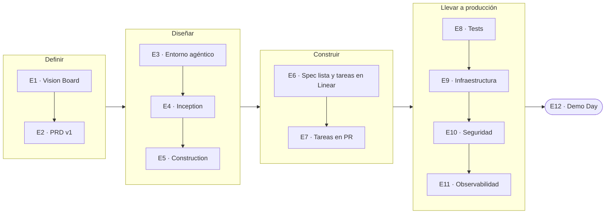

# AI for Developers | 30X — Cohorte 4

En 12 estaciones construyes **un producto real de punta a punta con IA**: lo defines, lo diseñas, lo implementas con agentes, lo pruebas, lo despliegas, lo aseguras y lo observas. Cierras con el **Demo Day del jueves 1 de octubre de 2026**.

Clases **martes y jueves de 7 a 9 PM** (hora Bogotá). Refuerzo de cada estación el **siguiente día hábil, de 7 a 8 PM**: lunes o miércoles.

## Empieza aquí

1. **Clona el repo:** `gh repo clone hardcore-ai/c4`
2. **Abre la estación de la semana** en la tabla de abajo. El enlace «Empieza aquí» lleva al archivo que hay que leer primero.
3. **Haz la tarea antes de la siguiente clase.** Cada estación recibe lo que produjo la anterior: si una tarea queda a medias, la siguiente estación arranca con menos.
4. **Dudas:** el grupo de WhatsApp de la cohorte es el primer recurso. Después, el refuerzo de esa estación.

## El hilo: un producto que crece estación por estación

## Las estaciones

| # | Fecha | Estación | Llegas con | Te vas con | Empieza aquí |
|---|---|---|---|---|---|
| 1 | Mar 25 ago | Introducción y demostración | Una idea, un problema de tu empresa o un producto del banco | Product Vision Board o Internal Solution Brief, con deep research de validación y de crítica | [README](estacion1/README.md) |
| 2 | Jue 27 ago | De la idea a la definición | Tu Vision Board | PRD v1 y entorno de coding agents listo | [README](estacion2/README.md) |
| 3 | Mar 1 sep | Ingeniería agéntica | PRD v1 y Claude Code funcionando | Coding agents, MCP, skills, hooks y subagentes en tu entorno | *Material en preparación* |
| 4 | Jue 3 sep | Diseñando el qué | PRD v1 | Los 6 artefactos de Inception con AI-DLC | [Runbook](estacion4/estacion4-runbook.md) |
| 5 | Mar 8 sep | Diseñando el cómo | Inception completa | Construction por unidad: modelo de dominio, NFR, infraestructura y ADR | [Runbook](estacion5/estacion5-runbook.md) |
| 6 | Jue 10 sep | Del spec al harness | Construction de al menos una unidad | Spec con nota A o B, `design.md` y grafo de tareas en Linear | [README](estacion6/README.md) |
| 7 | Mar 15 sep | Del backlog al merge | Paquete de tareas publicado | Al menos una tarea de tu paquete pasada por el ciclo completo: agente, PR, review y merge | [README](estacion7/README.md) · [Preparación](estacion7/preparacion.md) |
| 8 | Jue 17 sep | Aseguramiento de calidad | Producto implementado y corriendo en local | Skill de testing, 2 flujos E2E, 1 endpoint con tests de API y evaluación del agente | [Guía](estacion8/clase-8-estudiante.md) |
| 9 | Mar 22 sep | Despliegue (IaC) | Producto testeado | `architecture.md` y módulos Terraform corriendo en LocalStack | [Guía](estacion9/clase-9-estudiante.md) |
| 10 | Jue 24 sep | Seguridad | Producto desplegado | *Tarea en preparación* | [README](estacion10/README.md) |
| 11 | Mar 29 sep | Observabilidad y preparación del Demo Day | Producto desplegado y asegurado | Stack OpenTelemetry, 3 métricas del agente y un dashboard versionado | [Guía](estacion11/clase-11-estudiante.md) |
| **12** | **Jue 1 oct** | **Demo Day** | **Tu producto** | **Demo en vivo** | |

### Apoyo

| Material | Para qué |
|---|---|
| [Nivelación 2](nivelacion2/demo-paso-a-paso.md) | Construir tu primer agente: modelo + MCP + skill, con un caso de triage de tickets |

## Proyectos de ejemplo

Cada estación trae un ejemplo resuelto para que veas la profundidad esperada. Reemplázalo siempre por tu producto.

| Ejemplo | Dónde | Qué muestra |
|---|---|---|
| SkillWall Live | [estacion1/demo](estacion1/demo) | Inception resuelta con AI-DLC, para practicar Construction |
| AgentVault | [estacion2/docs](estacion2/docs) | Investigación y PRD |
| EntreVista AI | estaciones [4](estacion4/agentic_interviewer_ai), [5](estacion5/agentic_interviewer_ai), [6](estacion6/ejemplos/spec-review-entrevista-ai.md) y [11](estacion11/repos/requirement-hr-ia) | Un mismo producto de Inception a observabilidad |
| Repos de práctica | [estacion8/repos](estacion8/repos) y [estacion9/repos](estacion9/repos) | Tests E2E, API y de agentes; Terraform sobre LocalStack |

---

Para el equipo docente: [revisión de la experiencia del estudiante](EXPERIENCIA.md).

*AI for Developers | 30X — Cohorte 4 — Agosto–Octubre 2026*
